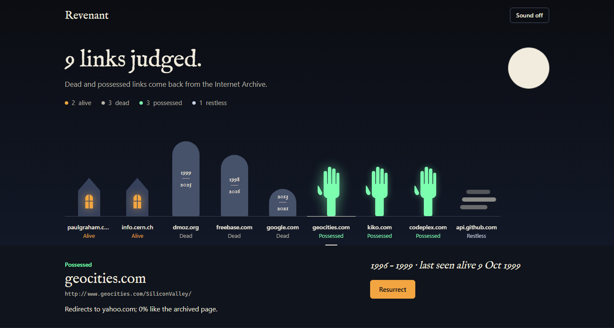
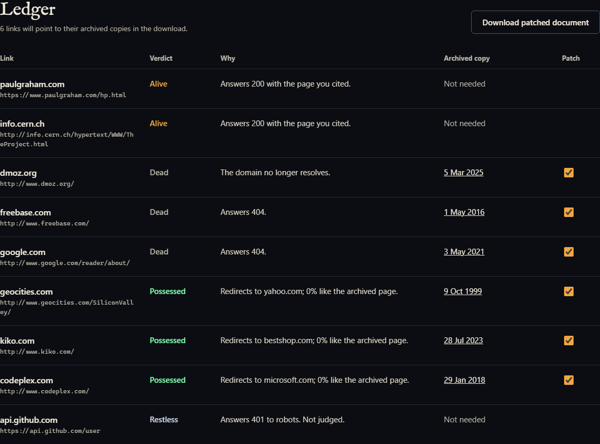

# Revenant

**Find the dead and possessed links in any document, and bring them back from the Internet Archive.**

Built for [Kiroween 2026](https://kiroween.devpost.com/), category: Costume Contest.

## What it is

Pew Research Center found that 38% of web pages that existed in 2013 were no longer accessible
a decade later ([When Online Content Disappears](https://www.pewresearch.org/data-labs/2024/05/17/when-online-content-disappears/),
17 May 2024). Some links are worse than dead: the URL still
answers, but the domain was sold and now serves something else. A normal link checker reports
those as fine. Revenant gives every link in a Markdown or HTML document one verdict, shows when
it died, and replaces it with its closest archived snapshot from the Wayback Machine. The same
engine runs as a web app, as a CLI for CI, and as an MCP server for AI agents.

| Verdict | Shape on the page | Meaning |
|---|---|---|
| `alive` | Lit window | Answers 2xx. Content is compared with the archive only after a redirect to another registrable domain. |
| `dead` | Tombstone | Gone: a confirmed DNS failure (NXDOMAIN or no A/AAAA record) or a 404/410. |
| `possessed` | Green zombie hand | A cross-domain redirect whose content is under 20% like the chosen archive copy. |
| `restless` | Fog patch | Cannot tell: 401 (needs a login), 403 and 429, 5xx twice, timeout, other connection errors, blocked addresses, other statuses, and an archive that could not be reached for the comparison. |

A 5xx is never `dead`. Revenant never cries wolf: when it is not sure, the verdict is `restless`.

- **Web:** paste a document, a page address or `owner/repo`. Links rise as a graveyard. Download the patched file.
- **CLI:** `revenant README.md --fix`. Exits 1 when links are dead or possessed, so CI can fail on rot.
- **MCP:** `check_links` and `resurrect` tools, so an agent can verify a URL before it cites it.

## Try it

Open <https://revenant.mgh-web.workers.dev> and press **Scan the sample**. Or press **Load the
sample**, then **Scan the document**. Or open a link that scans on load:

- <https://revenant.mgh-web.workers.dev/?sample=1>
- <https://revenant.mgh-web.workers.dev/?repo=sindresorhus/awesome>
- <https://revenant.mgh-web.workers.dev/?url=http://info.cern.ch/hypertext/WWW/TheProject.html>

The sample is [`samples/haunted-readme.md`](samples/haunted-readme.md): nine links with every verdict.

In the graveyard:

- Select a grave to read its inscription. **See every capture** opens the full Wayback list for that link.
- **Ask again** re-checks one link, for example when the archive was unreachable the first time.
- **Copy link** copies the address of this scan, so someone else can open the same graveyard.

## Screenshots

The graveyard after scanning the sample, with the possessed `geocities.com` link selected:



The same scene on a 390 px wide screen:


The ledger below the scene holds the same data as a plain table, with the archived copy of each link and a checkbox to include it in the patch:



These screenshots come from the production site (https://revenant.mgh-web.workers.dev), on the sample document, taken on {date}.

## CLI

Build once, then run the bundle with Node 22 or newer:

```sh
npm install
npm run build:cli
node dist/cli/index.js <file|url|owner/repo> [--fix] [--json]
```

`package.json` declares a `revenant` bin that points at `dist/cli/index.js`, so `npm link` in this
folder puts a `revenant` command on your PATH. The examples below use that name.

The input is a URL (starts with `http://` or `https://`), an `owner/repo` pair (when no file with
that name exists), or a file path. Files ending in `.html` or `.htm` are read as HTML, anything
else as Markdown.

### Default output

One line per link that is not alive: `[verdict] url — reason (archived copy)`.

```console
$ revenant samples/haunted-readme.md
[dead] http://www.freebase.com/ — Answers 404. (https://web.archive.org/web/20160501004947/http://www.freebase.com/)
[dead] http://www.dmoz.org/ — The domain no longer resolves. (https://web.archive.org/web/20170301000315/http://www.dmoz.org/)
[possessed] http://www.geocities.com/SiliconValley/ — Redirects to yahoo.com; 0% like the archived page. (https://web.archive.org/web/19990202115713/http://www.geocities.com/SiliconValley/)
[restless] https://api.github.com/user — Answers 401: needs a login. Not judged. (—)
9 links: 2 alive, 3 dead, 3 possessed, 1 restless
```

(Excerpt. The last line is the summary, written to stderr.) Lines appear as each check finishes, so they follow the order the checks finish, not the order of the document. The summary always lists all four counts and says 1 link: for a single link. It is written to stderr in every mode.

### `--fix`

Overwrites the file, replacing each dead or possessed link that has an archived copy with the
snapshot URL. It prints `Patched N links in <file>` to stderr, then the summary line, and no per-link lines. `--fix` works
on files only; with a URL it prints an error and exits 2.

```console
$ revenant docs/links.md --fix
Patched 6 links in docs/links.md
9 links: 2 alive, 3 dead, 3 possessed, 1 restless
```

The exit code still reflects what was found before the patch, so the run above exits 1. Run the
check again without `--fix` to confirm.

### `--json`

Prints one JSON object on stdout at the end, with one entry per distinct link, in document order (by first span). Nothing is streamed; the summary still goes to stderr. `resurrection` and `epitaph`
are present only when known. `spans` are character offsets of the link in the source. This is an
excerpt for two of the nine sample links:

```json
{
  "links": [
    {
      "url": "http://www.google.com/reader/about/",
      "verdict": "dead",
      "reason": "Answers 404.",
      "resurrection": "https://web.archive.org/web/20210503140021/http://www.google.com/reader/about/",
      "epitaph": { "first": "2013-07-02", "last": "2021-05-03" },
      "spans": [{ "start": 634, "end": 669 }]
    },
    {
      "url": "http://www.geocities.com/SiliconValley/",
      "verdict": "possessed",
      "reason": "Redirects to yahoo.com; 0% like the archived page.",
      "resurrection": "https://web.archive.org/web/19990202115713/http://www.geocities.com/SiliconValley/",
      "epitaph": { "first": "1996-12-21", "last": "1999-10-09" },
      "spans": [{ "start": 774, "end": 813 }]
    }
  ]
}
```

`epitaph` can also be the string `"unavailable"` when the archive could not be reached.
`--json` can be combined with `--fix`.

### Exit codes

| Code | Meaning |
|---|---|
| 0 | No dead or possessed links. `alive` and `restless` do not fail the run. |
| 1 | At least one dead or possessed link, or the input file could not be read. |
| 2 | Usage error: no input given, or `--fix` used with a URL or `owner/repo`. |

### GitHub Actions

Revenant is not published to npm, so the job builds it from a checkout of this repository.

```yaml
name: links
on:
  schedule:
    - cron: '0 6 * * 1'
  workflow_dispatch:

jobs:
  revenant:
    runs-on: ubuntu-latest
    steps:
      - uses: actions/checkout@v4
      - uses: actions/checkout@v4
        with:
          repository: MGHProjects/Revenant
          path: .revenant
      - uses: actions/setup-node@v4
        with:
          node-version: 22
      - run: npm ci && npm run build:cli
        working-directory: .revenant
      - run: node .revenant/dist/cli/index.js README.md
```

The last step fails the job (exit 1) when README.md has a dead or possessed link.

## MCP server

```sh
npm install
npm run build:mcp
```

This writes `dist/mcp/index.js`, a stdio server named `revenant`.

### Kiro

This repository already contains `.kiro/settings/mcp.json`:

```json
{
  "mcpServers": {
    "revenant": {
      "command": "node",
      "args": ["./dist/mcp/index.js"]
    }
  }
}
```

### Other clients

Use the same `mcpServers` form in the client's config file, with an absolute path, because most
clients do not start the server from this folder:

```json
{
  "mcpServers": {
    "revenant": {
      "command": "node",
      "args": ["/absolute/path/to/Revenant/dist/mcp/index.js"]
    }
  }
}
```

### Tools

**`check_links`** checks links for rot.

- `text` (string, optional): Markdown containing links.
- `urls` (string array, optional): bare URLs. Used when `text` is empty or missing.
- Returns JSON text: `{ total, capped, capLimit, judgements }`. `capLimit` is 200, and `capped` is
  true when the input had more links than that. Each judgement has the link, `verdict`, `reason`,
  and, for dead or possessed links, `resurrection` and `epitaph`. An `archiveNote` string is added
  when the archive could not be reached or has no copy.
- Input with no URLs returns an error result with the text `no URLs found`.

**`resurrect`** finds the Wayback snapshot of one URL.

- `url` (string, required)
- `date` (string, optional): `YYYY-MM-DD`. The snapshot closest to that date is returned. Without it, the most recent one.
- Returns one of:
  - found: `{ "url", "found": true, "snapshotUrl", "snapshotDate" }`
  - not found: `{ "url", "found": false, "lost": true, "archiveAvailability": "known" }`, meaning the archive answered and holds no copy
  - undecided: `{ "url", "found": false, "lost": false, "archiveAvailability": "unknown" }`, meaning the archive could not be reached, so nothing is claimed
- A missing `url` returns an error result (`url is required`). A `date` in any other format returns `date must be YYYY-MM-DD`.

## Local development

Requires Node 22 or newer.

```sh
npm install
npm run dev     # Vite on http://localhost:5173, proxying /api to wrangler dev on 127.0.0.1:8787
npm test        # Vitest: unit and fast-check property tests
npm run check   # tsc --noEmit
npm run deploy  # builds CLI, MCP and web, then wrangler deploy (needs a Cloudflare login)
```

If port 5173 is taken, Vite picks the next free port and prints it. `npm run dev` stops both
servers on Ctrl+C.

Layout:

```
src/core     pure engine: extract, classify, similarity, patch, guard. No network, no clock.
src/core/lives.ts       picks a URL's longest continuous life and the copy to open
src/net      the only code that touches the network: fetcher, Wayback client, judge-link.ts
             (one judgement per link), github-readme.ts (owner/repo input), scan loop
src/worker   Hono app: POST /api/scan, POST /api/resolve, static assets
src/cli      main.ts (entry) and run.ts (the revenant command)
src/mcp      main.ts (entry) and server.ts (stdio MCP server)
web          Vite app: the graveyard
```

Imports go one way: `worker`, `cli`, `mcp` and `web` use `net`, and `net` uses `core`. Because
`src/core` is pure, its correctness properties are tested with fast-check.

## Field test

Run on 26 Nov 2026, from source at commit `7637241`. The working tree had uncommitted changes:
the fixes described below were not yet committed.

**Method.** The first 200 links of four public READMEs, one README at a time, with
`revenant <owner/repo> --json` on a local machine (Node 22), run from Kiro. No `GITHUB_TOKEN`. Requests to the
Internet Archive went one at a time with a 1 s gap. After each run an agent run from Kiro opened every dead and
possessed link (an HTTP request that follows redirects, a DNS lookup, and for possessed
links a look at the archived copy) and classified it. Here, a **true positive** means the page
the author cited can no longer be read at that address. A **false alarm** means the cited
content can still be read at the place the link leads to. **Unclear** means the agent could not decide
from a few requests.

| README | Links scanned | Alive | Dead | Possessed | Restless | Dead or possessed with an archived copy |
|---|---|---|---|---|---|---|
| mtdvio/every-programmer-should-know | 200 | 176 | 7 | 1 | 16 | 8 of 8 |
| kdeldycke/awesome-falsehood | 168 | 162 | 1 | 0 | 5 | 1 of 1 |
| donnemartin/system-design-primer | 200 | 160 | 3 | 11 | 26 | 14 of 14 |
| danistefanovic/build-your-own-x | 200 | 177 | 4 | 2 | 17 | 6 of 6 |
| Total | 768 | 675 | 15 | 14 | 64 | 29 of 29 |

No link in these runs finished with the archive unreachable.

**The first run.** On 26 Nov 2026 the same four READMEs were scanned with the deployed version
before these fixes. That run, which is not part of the table above, scanned 768 links and flagged 28
as dead or possessed. 11 of the 28 were false alarms, of three kinds. Each became a rule and a test:

1. Markdown links with parentheses were cut at the first `)`. Five Wikipedia links in
   system-design-primer were judged dead. Task 18.1: the extractor now reads the whole
   destination with balanced parentheses. Covered by Property 18 in
   `test/extract.prop.test.ts` and by the parentheses cases in `test/extract.test.ts`.
2. Renames were judged possessed: five `twitter.com` status links to x.com in awesome-falsehood
   and `exercism.io` to `exercism.org` in every-programmer-should-know. Task 18.2: the same name
   under another suffix, and a short list of known renames (`src/core/known-renames.ts`), are
   `alive`; a live page with too little text to compare is `restless`. Covered by
   Properties 6h, 6i and 6j in `test/classify.prop.test.ts` and by `test/judge-rename.test.ts`.
3. The Internet Archive throttled bulk scans, so archive lookups failed and dead links got no
   archived copy (13 cross-domain links "archive could not be reached" in system-design-primer, 4 links
   to web.archive.org "Connection failed", 7 of 8 dead links without a copy, and 4 of 4 in
   build-your-own-x). Task 18.3: every request to the archive goes through one queue with a minimum gap and
   `Retry-After`, and `scan()` asks once more for the judgements whose archive answer was
   unavailable. Covered by `test/archive-queue.test.ts`, `test/archive-queue-clients.test.ts`
   and, for the final retry, Property 19 in `test/scan-retry.test.ts`.

**This run.** The READMEs themselves may have changed since the first run, so the two runs
are not a before and after on identical input. The first run found 28 flagged links of 768; this
one found 29 of 768. None of the 29 is a Wikipedia, `twitter.com` or `exercism.io` link, none has
`archiveUnavailable`, and all 29 have an archived copy. The agent's classification of the 29:

| Classification | Count | Links |
|---|---|---|
| True positive | 18 | 15 dead links (9 answer 404, 6 on hosts that do not resolve), and 3 nginx.com pages that now redirect to the generic F5 NGINX product page |
| False alarm | 6 | The cited content can be read at the new address: targetprocess.com (now apptio.com), nginx.com HTTP glossary page (now f5.com), consul.io docs (now developer.hashicorp.com), puncsky.com (now tianpan.co), varnish-cache.org (now varnish.org), developers.google.com/protocol-buffers (now protobuf.dev) |
| Unclear | 5 | nginx.com reverse-proxy-vs-load-balancer (f5.com has an entry on reverse proxies, not the same article), coreos.com/etcd/docs (now the etcd.io home page), consul.io getting-started checks (now a different tutorial), handmadehero.org (now a section of mollyrocket.com), scottlilly.com/build-a-cwpf-rpg (now the home page of soscsrpg.com) |

Of the 15 dead links, 9 answer 404 and 6 are on hosts that do not resolve: `katemats.com` (no
address record), `sci-hub.se`, `ucoder.com.br`, and three pages on `codeslinger.co.uk`. By README:
every-programmer-should-know has 7 true positives and 1 false alarm; awesome-falsehood has 1 true
positive; system-design-primer has 6 true positives, 5 false alarms and 3 unclear;
build-your-own-x has 4 true positives and 2 unclear.

**What remains.** All 6 false alarms are possessed verdicts on a company or project that moved
to a new domain, sometimes after an acquisition or a site redesign. The text of the new page is
different enough from the archived one that the similarity falls under 20%, so the engine cannot
tell a rewritten page from a replaced one. The 5 unclear links are the same pattern with a weaker
match. Redirects of nginx.com, consul.io and coreos.com are still reported possessed, which is
right when the page you cited is gone and wrong when the new site holds the same article, and
Revenant does not tell these apart. Of the 64 restless links, 55 answered 403 to robots, 4 did not answer
within 8 s, 2 answered 429, and one each answered 451, failed to connect, or redirected to a page
with too little text to compare. Revenant never calls these dead, so a site that blocks robots
stays unchecked. The agent did not open the 64 restless links.

**Manual review.** On 26 Nov 2026 the project author also reviewed two READMEs by hand, outside
the runs above. These are the author's hand counts. No table of ours sits behind them. The review
covered the full READMEs of `codecrafters-io/build-your-own-x` (392 links) and
`donnemartin/system-design-primer` (344 links), not the first 200 links that the runs above scanned.
It found 14 dead links. All 14 fail at the cited address. Three of the 14 had moved to a live
address: a renamed GitHub account, an article now on medium.com, and a SmartBear page at a new
path. The right fix for those is the new address, which Revenant does not find. For the 11 that
are gone, the archived copy Revenant chose was the real page in 9 of the 11. The other 2 were a
"launching soon" placeholder (`creative-artworks.eu`, where the placeholder was captured for six
years) and a redirect stub (`sj14.gitlab.io`). A good copy existed for both. One host,
`codeslinger.co.uk`, did not resolve on the day but was captured alive on 3 Nov 2026.
## Limits worth knowing

- `possessed` is only detected when the link redirects to another registrable domain. A hijacked domain that serves new content at the same address is reported `alive`.
- A redirect to the same name under another suffix (`exercism.io` to `exercism.org`) or to a known rename (`twitter.com` to `x.com`, `repl.it` to `replit.com`) is reported `alive`, not `possessed`. That is a blind spot: a squatter who owns the same name under another suffix (`foo.com` to `foo.net`) is reported `alive` too, and the known-rename list is short.
- Pages decay before they die, so Revenant opens a copy from up to a year before the last capture; See every capture shows the rest.
- A scan covers at most 200 links. The web app says so when the cap is hit.
- The Worker runs on the Cloudflare free plan, so `POST /api/scan` accepts at most 3 URLs per request. The web app sends batches of 3, two at a time.
- In the Worker, text similarity compares only the first 64 KB of visible text on each side. The CLI and MCP server run on Node and use the same core.
- Response bodies are read up to 512 KB. Outbound requests have an 8 s timeout and follow at most 5 redirects.
- The Worker keeps Wayback answers for 24 h in memory only. It does not use the Cache API, because those calls count toward the free plan's 50 subrequests per request. The memory lives inside one Worker isolate, so a later request can miss the cache and ask the archive again.
- Requests to the Internet Archive are made one at a time, so a large scan takes longer.
- The Wayback Machine can throttle the Worker (HTTP 429) or time out under bursts of requests. A link that needed the archive for comparison is then `restless`, not `dead` or `possessed`. Repeated back-to-back CLI runs can show more `restless` links than a single run.
- For `owner/repo` input, Revenant first tries `raw.githubusercontent.com` on the default branch for `README.md`, `readme.md`, `README`, `Readme.md` and `README.markdown`, which GitHub does not rate-limit. Only if none exists does it call the GitHub API (for READMEs with another name or in `docs/`). The unauthenticated API allows 60 requests per hour per IP, so set `GITHUB_TOKEN` in the CLI environment to raise that; the token is sent to the API only. If GitHub still rate-limits the request, the web app asks you to paste the document.
- Outbound requests are limited to http and https hosts by name. IP literals, `localhost`, `*.local`, `*.internal`, `*.localhost` and URLs with credentials are refused, and the link is `restless` (not checked).
- Review each archived copy before you commit it. Revenant picks the copy it judges best, but that choice can be a placeholder or a redirect stub. For a page that has moved, it finds the archived copy of the old address, not the new address.
- A domain that does not resolve today may come back. A link judged dead because of a DNS failure reflects the day you scanned.

## Built with Kiro

- `.kiro/steering/`: product, tech, structure and UI ("costume") direction
- `.kiro/specs/revenant/`: requirements, design and tasks generated from the brief
- `.kiro/hooks/`: typecheck on save, core and property-test sync, costume and accessibility review
- `.kiro/agents/gravekeeper.md`: read-only reviewer agent
- `.kiro/settings/mcp.json`: registers the Revenant MCP server for Kiro
- `docs/brief/`: requirements, design brief and
  [calibration data](docs/brief/calibration.md) measured on real links
- `docs/design/`: the UI reference mocks

The brief in `docs/brief/` and the UI reference in `docs/design/` were written with another AI
assistant (Claude). Kiro generated the spec (`.kiro/specs/revenant/`) and all application code.

## License

MIT
